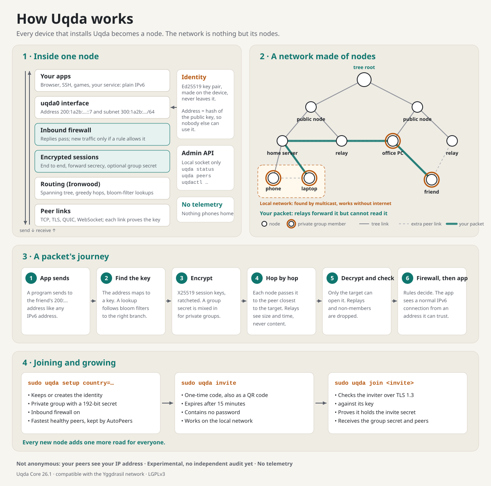

# Uqda · عُقدة

[العربية](README.ar.md) · [How it works](docs/how-it-works.md) · [Build on Uqda](docs/build-on-uqda.md) · [Documentation](docs/README.md) · [Releases](https://github.com/Uqda/Core/releases)

**Uqda is a worldwide encrypted network made only of its users' devices.**

*Uqda* (عُقدة) is Arabic for *node*, and that is the whole idea. Every device
that installs Uqda becomes a node. Every node gets a permanent encrypted
address, connects to the nodes around it, and helps carry the network's
traffic. There is no company in the middle, no account to create, and no
server that can be switched off. The network is its users, and it grows each
time someone joins.

> **Experimental project.** Uqda is tested extensively but has not had an
> independent security audit. Do not rely on it where a failure would put
> people or critical systems at risk.
>
> **Not anonymous.** Uqda encrypts traffic between nodes, but your peers see
> your IP address and other nodes can see your Uqda address. Uqda contains no
> telemetry and its developers run no servers that see your traffic; see
> [privacy](PRIVACY.md).



## A network that builds itself

```
        your phone ─── your laptop ─── your home server
                            │                 │
              (same Wi-Fi, no internet)    internet
                                              │
   a friend's PC ─── public node ─── public node ─── a server abroad
```

1. **Install, and you are a node.** Your device generates its own key pair and
   an IPv6 address calculated from it, such as `200:1a2b:3c4d::7`. Nobody
   issues it, and nobody else can use it.
2. **Nodes find each other.** Uqda connects to nearby nodes on your local network
   by itself, and to fast public nodes on the internet.
3. **Every node carries traffic.** Packets travel node to node until they arrive,
   encrypted end to end. Nodes in the middle forward what they cannot read.
4. **The network grows.** Each new node is one more path for everyone.

Uqda runs inside the existing worldwide [Yggdrasil](https://yggdrasil-network.github.io/)
network and speaks its protocol, so a new Uqda node joins thousands of existing
nodes on day one: a global network inside the global internet.
[How it works](docs/how-it-works.md) explains identity, routing and encryption
in detail.

## Why use it

| | Uqda | Typical VPN or mesh service |
|---|---|---|
| Who runs the network | Its users' nodes | A company |
| Account | None | Required |
| Can it be switched off, blocked at one server, or repriced? | No central server to do it to | Yes |
| Works between devices with no internet | Yes, on the local network | Usually no |
| Reach a device behind NAT without opening ports | Yes | Yes |
| Add a device | `uqda invite`, then `uqda join` | Sign in to the vendor |
| Who may reach your services | Built-in firewall, rules by device key | The vendor's dashboard |

Where others are stronger today: they open direct paths through NAT, while
Uqda's traffic sometimes goes through other nodes.

## Two kinds of network, one infrastructure

- **Private group:** only devices that share your group secret can talk to you,
  even though public nodes still carry the encrypted traffic. For your own
  devices, a family, a team. This is the default.
- **Public network:** reach, and be reached by, any node in the world, with the
  firewall deciding what is open. For services you want everyone to use.

See [networks](docs/networks.md).

## Start in three commands

Install for your system ([all options](docs/installation.md)):

| System | Install |
|---|---|
| Linux | `curl -fsSLo uqda-install.sh https://raw.githubusercontent.com/Uqda/Core/main/contrib/install/linux.sh && sudo sh uqda-install.sh install` |
| macOS | `brew install --cask Uqda/tap/uqda` |
| Windows | The `.msi` for your system from [Releases](https://github.com/Uqda/Core/releases) |
| Debian / Ubuntu | The `.deb` from [Releases](https://github.com/Uqda/Core/releases) |
| Umbrel | Community store `https://github.com/Uqda/umbrel-app-store` → **Uqda Network** |

Then:

```sh
sudo uqda setup country=germany   # identity, private network, firewall, fast peers kept healthy
sudo systemctl restart uqda       # setup prints the right command for your system
sudo uqda invite                  # on each new device: sudo uqda join <invite>
```

`uqda find` lists countries with public nodes. [Getting started](docs/getting-started.md)
walks through everything, including reaching a service on another device.

## Build on Uqda

Uqda gives every node an address that proves who it is. The rest is up to you:
websites, chat, file sharing, games, tools, smart-home control, apps.
**Anything that listens on IPv6 already works on Uqda.**

```sh
python3 -m http.server 8080 --bind ::      # then open http://[your-address]:8080/
```

[Build on Uqda](docs/build-on-uqda.md) covers hosting, using addresses as
identity, the admin API for tools, and the mobile SDKs.

## Everyday commands

| Command | What it does |
|---|---|
| `uqda status` | Health checks, each with its fix |
| `uqda info` | Your address and public key |
| `uqda peers` | Your node's links, traffic and latency |
| `uqda autopeers` | Automatically kept public peers |
| `uqda firewall` | Firewall rules and blocked packets |
| `uqda test ADDRESS` | Reachability and packet loss to another node |
| `uqda help COMMAND` | Help for any command |

## Security in brief

- **Identity:** Ed25519 keys; your address is derived from your key and cannot be claimed without it.
- **Encryption:** sessions use X25519 and XSalsa20-Poly1305 with ephemeral, ratcheted keys, giving forward secrecy and replay protection. Relays carry traffic they cannot read.
- **Private groups:** the group secret is stretched with Argon2id; outsiders cannot open sessions with members.
- **Firewall:** on by default for new nodes; only replies and the services you allow get in.
- **Handshake:** Uqda nodes prove their key on every connection, so recorded handshakes cannot be replayed. Connection floods are capped.
- **Invites:** one-time and expiring, verified over TLS 1.3 against the inviting node's key.

Uqda does **not** provide anonymity, and the admin API is local and has no
authentication. Read the [security model](docs/security.md); report
vulnerabilities privately as described in [SECURITY](SECURITY.md).

## The project

- Every change runs the full test suite on Linux, macOS and Windows: race
  detection, fuzzing, packaging for every supported system, and a compatibility
  gate against the official Yggdrasil implementation. See [testing](docs/testing.md).
- `beta` gets new work first; `main` holds stable releases. See [branching](docs/branching.md).
- Contributions are welcome: see [CONTRIBUTING](CONTRIBUTING.md), the
  [roadmap](docs/roadmap.md) and the [CHANGELOG](CHANGELOG.md).

## License and attribution

Uqda Core is licensed under LGPLv3 with the linking exception in [LICENSE](LICENSE).
It is derived from Yggdrasil, and routing and encrypted sessions come from
Ironwood; see [NOTICE](NOTICE.md) and
[third-party licenses](THIRD_PARTY_LICENSES.md). Uqda is an independent project,
not affiliated with or endorsed by the Yggdrasil project; "Yggdrasil" is used
only to describe compatibility.

You are responsible for how you use Uqda and for what you publish or reach
through it, under the laws that apply to you. Report abuse or security problems
as described in [SECURITY](SECURITY.md).

---

*Uqda is an experimental project, provided as is and without warranty.*
