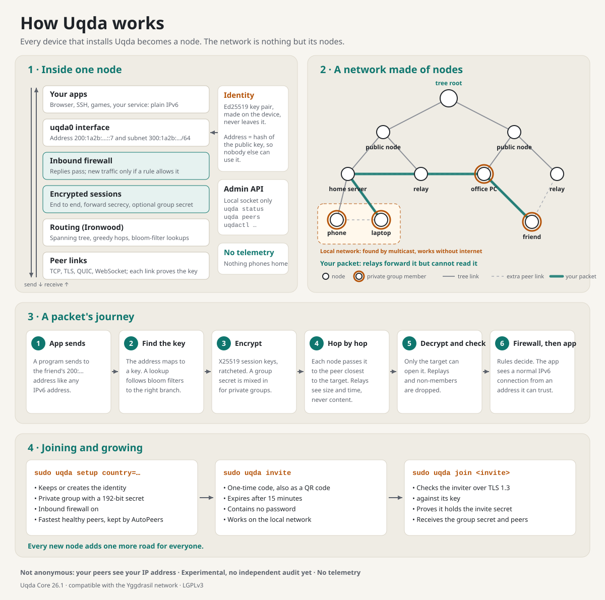

# How the Uqda network works

Uqda (عُقدة) means *node*. The name is the design: **the network is made of
nothing but nodes.** There is no company server in the middle, no account
system and no central directory. Every device that runs Uqda is a node, and
every node is part of the network that carries everyone's traffic.



The same diagram in Arabic: [how-uqda-works.ar.svg](assets/how-uqda-works.ar.svg).
The sections below explain each part.

## 1. A network that is its own infrastructure

When you install Uqda, your device does three things at once:

1. **It gets an identity**, a key pair generated on the device. Nobody issues it.
2. **It connects to a few nearby nodes**, its *peers*: other nodes on your local
   network (found automatically), or public nodes on the internet.
3. **It becomes a router.** It forwards encrypted traffic for other nodes when it
   lies on the best path between them.

So the network grows by itself. Each new node adds one more place to connect to
and one more path between other nodes. No one has to approve it, register it or
pay for it.

```
   phone ── laptop ── home server ═══ internet ═══ public node ── office PC
                │                                       │
          (local network,                        (another country)
           no internet needed)
```

Uqda runs inside the existing worldwide [Yggdrasil](https://yggdrasil-network.github.io/)
network and speaks its protocol, so a Uqda node joins thousands of existing
nodes on day one. In short: a global network running on top of the internet.

## 2. Identity and addresses

- Each node has an **Ed25519 key pair**. The private key never leaves the device.
- The node's **IPv6 address is calculated from its public key**, for example
  `200:1a2b:3c4d::7`. Every Uqda address starts with `200::/7`.
- Each node also gets a **routed `/64` subnet** (starting `300::/7`) for devices
  behind it.

Because the address comes from the key, **nobody can use your address without
your private key.** Programs that receive a connection from a Uqda address know
it really came from the holder of that key.

## 3. Peers: how nodes connect

A **peer** is a direct link between two nodes. Links can use TCP, TLS, QUIC,
WebSocket, SOCKS or Unix sockets, so they work through most networks.

| How a peer is found | When |
|---|---|
| Local discovery (multicast) | Automatically, on the same local network, even without internet |
| Configured `Peers` | Nodes you choose, such as your own server |
| `uqda find` and `AutoPeers` | Public nodes, chosen by measured speed and replaced when they fail |
| `uqda invite` / `uqda join` | Your private group's nodes, shared securely |

Every link starts with a handshake in which each node proves it holds its key.
Between Uqda nodes this proof covers a fresh random value on every connection,
so a recorded handshake cannot be replayed to impersonate a node.

## 4. Routing: how a packet finds its way

No node knows the whole network. Routing works with small local knowledge:

1. **A spanning tree.** Nodes agree, by gossiping with their peers, on a tree
   that connects the whole network. Each node only keeps small records about its
   own position and its peers. This gives every node *coordinates*.
2. **Greedy routing.** A packet moves, hop by hop, to the peer whose coordinates
   are closest to the destination.
3. **Lookups.** To find where a key is, a node sends a small lookup along the
   tree. Each link keeps a compact *bloom filter* of the keys reachable through
   it, so lookups only travel towards the right part of the network.
4. **Repair.** When a link breaks, the sender is told, looks the destination up
   again, and traffic takes the new path.

This lets the network grow to very many nodes while each node stores only a
small, fixed amount per peer. Routing comes from the Ironwood library, the same
one Yggdrasil uses.

## 5. Encryption: what anyone in the middle can see

Traffic between two nodes is **encrypted end to end**:

- Sessions use X25519 key agreement and XSalsa20-Poly1305 authenticated
  encryption (NaCl box), with **ephemeral keys and ratcheting**. That gives
  forward secrecy, so old traffic stays protected even if a key leaks later,
  and it rejects replayed packets.
- **Nodes in the middle forward packets they cannot read or change.**
- Optional TLS or QUIC on a link also hides protocol details from your ISP.

What a relay *can* see: that traffic passes, how much, and when. Uqda is not an
anonymity network.

## 6. Public network and private groups

Every node is on the same worldwide network. A setting decides who may talk to it:

- **Public:** any node can open an encrypted session with you.
- **Private group:** nodes share a group secret, stretched with Argon2id and
  mixed into session encryption. **Nodes without it cannot open a session with
  you at all**, although they may still relay your encrypted traffic.

Groups still use public nodes as roads. They only limit who can talk to whom.
See [networks](networks.md).

## 7. What protects each node

| Layer | Protection |
|---|---|
| Inbound firewall | Unsolicited traffic is dropped unless a rule allows it; on by default for new nodes ([firewall](firewall.md)) |
| Handshake limits | At most 256 pending handshakes per node and 8 per source, so connection floods cannot exhaust it |
| Admin API | Local only, with connection, size and idle limits |
| Invites | One-time, expiring, verified over TLS 1.3 against the inviting node's key ([invites](invites.md)) |

## 8. What runs where

| Piece | Role |
|---|---|
| `uqda` | The node itself (the daemon), plus everyday commands such as `uqda status` |
| `uqdactl` | Administration over the local admin socket |
| Ironwood | Routing and encrypted sessions |
| The `uqda0` interface | Where your programs see the network, as ordinary IPv6 |

Because the network appears as ordinary IPv6, **existing programs work
unchanged**: browsers, SSH, file sharing, games, chat servers. That is what
makes it possible to build on Uqda; see [build on Uqda](build-on-uqda.md).

## Limits, stated plainly

- Paths go through other nodes rather than always being direct, so some routes
  are slower than with services that punch holes through NAT.
- Uqda hides content, not who talks to whom.
- It is an experimental project without an independent security audit yet.

More detail: [architecture](architecture.md) for the code layout,
[security](security.md) for the threat model, and
[compatibility](compatibility.md) for how Uqda stays compatible with Yggdrasil.
