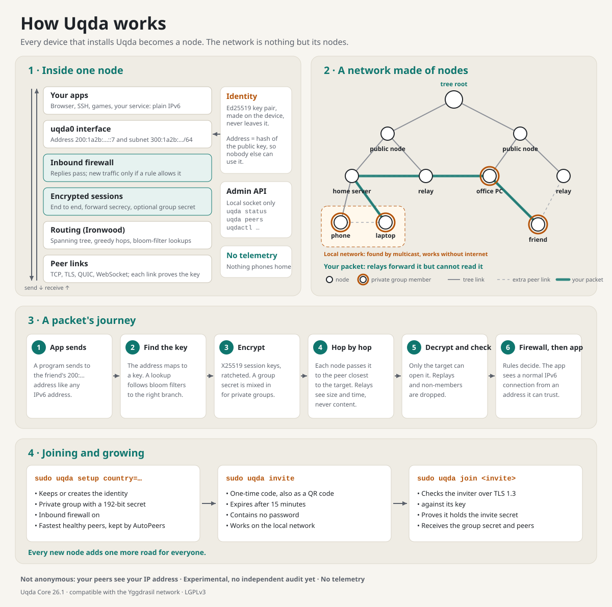

# Uqda 26.1.1

**Uqda is a worldwide encrypted network made only of its users' devices.**
Every device that installs it becomes a node (عُقدة): it gets a permanent
address derived from its own key, connects to the nodes around it, and helps
carry the network's traffic. There is no company in the middle, no account and
no central server. Uqda runs inside the worldwide Yggdrasil network and stays
compatible with it.

26.1.1 is a maintenance release for everyone on 26.1. It makes Uqda work out of
the box on Windows, shares less about your node by default, and ships every
license and notice with the packages. There are no protocol changes.

> **Experimental project.** Uqda is tested extensively but has not had an
> independent security audit. Do not rely on it where a failure would put
> people or critical systems at risk. **Uqda is not anonymous:** your peers see
> your IP address. See [privacy](https://github.com/Uqda/Core/blob/main/PRIVACY.md).

Technical overview of the whole network. In Arabic: [how-uqda-works.ar.svg](https://github.com/Uqda/Core/blob/main/docs/assets/how-uqda-works.ar.svg).
Full explanation: [how Uqda works](https://github.com/Uqda/Core/blob/main/docs/how-it-works.md).

## What's new

### Windows works after a normal install

- **`uqda` is on the `PATH`.** The installer adds the Uqda folder to the system
  `PATH`, so `uqda status`, `uqda invite` and `uqda join` work in a new
  administrator terminal. 26.1.0 needed the full path
  `C:\Program Files\Uqda\uqda.exe`. Uninstalling removes the entry.
- **Local network allowed.** The installer adds a Windows Defender Firewall
  rule, *Uqda (local network)*, for `uqda.exe` from the local subnet on
  *Private* networks only. Before, Windows silently blocked local discovery,
  LAN peerings and invites. Public networks and the internet stay closed. The
  rule is removed on uninstall.
- If your Wi-Fi is classified as *Public*, `join` still cannot reach the
  inviting PC. [Getting started](https://github.com/Uqda/Core/blob/main/docs/getting-started.md#4-add-another-device)
  shows how to mark your own home network as *Private*.

### Faster, smaller invites

- An invite lists at most four addresses: real LAN addresses first, then
  IPv6, then public addresses. Addresses of virtual adapters (WSL, Hyper-V,
  Docker, VirtualBox, VPN tunnels) are left out, so the joining device no
  longer waits on addresses it cannot reach.
- The QR code uses low error correction, so it is smaller and easier to scan
  from a terminal.

### Shares less by default

- New configurations set `NodeInfoPrivacy: true`: other nodes can no longer
  ask yours for its platform, architecture and Uqda version. `NodeInfo` stays
  empty. Existing configurations are not changed; set `NodeInfoPrivacy: true`
  yourself if you want the same.
- The configuration file now warns that `NodeInfo` is readable by every node
  on the network.

### Licenses and notices in every package

- [THIRD_PARTY_LICENSES](https://github.com/Uqda/Core/blob/main/THIRD_PARTY_LICENSES.md)
  lists every component in the binaries with its license. CI fails if a new
  dependency is missing from it or uses a license outside the allowed set.
- The `.deb` installs `LICENSE`, `NOTICE.md`, `THIRD_PARTY_LICENSES.md` and
  `PRIVACY.md` in `/usr/share/doc/uqda/`; the MSI installs them next to
  `uqda.exe`, with the Wintun driver's own license as `wintun-LICENSE.txt`;
  the Docker image has them in `/usr/share/licenses/uqda/` and gains OCI
  `source`, `licenses` and `description` labels.
- New [PRIVACY](https://github.com/Uqda/Core/blob/main/PRIVACY.md) page, in English and
  Arabic: what a node shares and with whom. Uqda contains no telemetry, no
  analytics and no update check.
- [SECURITY](https://github.com/Uqda/Core/blob/main/SECURITY.md) now has an e-mail contact
  (Uqda@proton.me), response targets and a safe harbour for good-faith
  research. NOTICE records where Uqda was forked and what it changed.

### Also fixed

- `uqda info` shows the release name ("Uqda Core 26.1.1") like the other
  commands.
- The Debian package names a maintainer contact and homepage.

### Dependencies

quic-go 0.65.0, golang.org/x/net 0.62.0, cheggaaa/pb 3.3.0, go-colorable
0.1.16, go-runewidth 0.0.31. `govulncheck` reports no known vulnerabilities.

## Install or update

| System | Install | Update |
|---|---|---|
| Linux (systemd, x86-64 and arm64) | `curl -fsSLo uqda-install.sh https://raw.githubusercontent.com/Uqda/Core/main/contrib/install/linux.sh && sudo sh uqda-install.sh install` | `sudo sh uqda-install.sh update` |
| Debian and Ubuntu | `sudo apt install ./uqda-26.1.1-ARCH.deb` | install the newer `.deb` |
| macOS (Intel and Apple Silicon) | `brew install --cask Uqda/tap/uqda`, or the `.pkg` below | `brew upgrade --cask Uqda/tap/uqda` |
| Windows (x64, x86, ARM64) | the `.msi` for your system below | install the newer `.msi` over the old one |
| Docker | `uqda-26.1.1-oci.tar` below | |
| Android and Apple apps | SDKs: `.aar` and `.xcframework` below | |

Updates keep your node identity and configuration. Verify downloads against
`SHA256SUMS`. On Windows, open a new administrator PowerShell after updating
so it picks up the new `PATH`.

## Compatibility

- No protocol changes. Peering, routing and sessions with Yggdrasil, 26.1.0
  and earlier Uqda releases are unchanged, checked against the official
  Yggdrasil implementation.
- Configuration files from 26.1.0 work unchanged.

## Known limits

- When a configured listener fails to start, the error in the local log can
  include a `password=` value from that listener's URI. Nothing is sent
  anywhere; remove it before sharing a log. Fixed in the next release.
- Some paths go through other nodes rather than directly through NAT, so they
  can be slower than services that punch holes through NAT.
- Uqda hides content, not who is talking to whom. It is not an anonymity network.
- The Android and Apple files are SDKs for app developers, not ready-made apps.
- Installers are not code-signed yet, so Windows SmartScreen and macOS may
  warn. Verify them against `SHA256SUMS`.
- On Umbrel the app stays on its tested 26.0.5 package for now.

Full list of changes: [CHANGELOG](https://github.com/Uqda/Core/blob/main/CHANGELOG.md).

*Uqda is an experimental project, provided as is and without warranty.*
